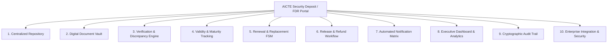

# AICTE Security Deposit & Fixed Deposit Receipt (FDR) Management Portal
## Streamlined Problem Statement & Functional Blueprint

> **Problem Statement ID:** SIH-AICTE-FDR-2024 / SIH-PS-01  
> **Target Authority:** All India Council for Technical Education (AICTE), Ministry of Education, Government of India  
> **Target Bureau:** Regulation Bureau & Regional Directorates  
> **Domain:** Smart Governance, FinTech, Regulatory Compliance & Automated Document Forensics  

---

## 1. Executive Summary

Technical education institutions operating under the mandate of the **All India Council for Technical Education (AICTE)** are required to create and maintain financial security deposits—predominantly in the form of **Fixed Deposit Receipts (FDRs)**—pledged jointly or under lien to AICTE. These deposits serve as statutory safeguards for:
- Guaranteeing financial viability and sustainability of approved engineering, technology, management, and pharmacy institutions.
- Protecting the interests of enrolled students and faculty members.
- Ensuring fulfillment of endowment/contingency conditions during the prescribed lock-in tenure (typically 8 to 10 years).

Currently, FDR management across thousands of technical institutions and regional offices suffers from **data fragmentation, paper-heavy documentation, manual banking correspondence, lack of proactive maturity monitoring, and vulnerabilities to premature encashment or forged receipts**.

This initiative aims to conceptualize, engineer, and deploy an **end-to-end, zero-trust, enterprise-grade Security Deposit / FDR Lifecycle Management Portal**. The system will automate document scrutiny, integrate with financial verification protocols, provide real-time maturity tracking with escalation triggers, streamline release/refund workflows through maker-checker controls, and maintain an immutable audit trail.

---

## 2. Background & Regulatory Context

### 2.1 Statutory Mandate
Under the **AICTE Act, 1987 (52 of 1987)** and the annual **Approval Process Handbook (APH)**, any applicant entity seeking to establish a new technical institution, start new programs, or increase intake must pledge a designated security deposit. 

```
                                  +------------------------------------+
                                  |     Trust / Society / Company      |
                                  |   (Applicant / Sponsor Body)       |
                                  +-----------------+------------------+
                                                    |
                                      Deposits Fund | (Tenure: 8-10 Yrs)
                                                    v
+-------------------------------+ Lien Marked / Joint +-------------------------------+
|     Scheduled Commercial      |<------------------->|             AICTE             |
|             Bank              |     FDR Pledged     |     (Regulation Bureau)       |
+-------------------------------+                     +-------------------------------+
```

### 2.2 Standard Regulatory Lifecycle of an AICTE FDR
1. **Creation & Lien Marking:** The applicant deposits funds in a Scheduled Commercial Bank in a joint account (or lien marked in favor of the Member Secretary, AICTE, or Regional Officer).
2. **Submission:** The physical/scanned FDR receipt along with bank confirmation certificates is submitted during the annual approval cycle.
3. **Custody & Lock-in:** The deposit remains locked for the statutory period (e.g., 8–10 years). Interest may be accumulated or rolled over per regulations.
4. **Renewal / Replacement:** If the maturity tenure of the instrument expires before the statutory obligation concludes, the institution must renew or replace the FDR.
5. **Encashment / Penal Recovery:** In cases of severe regulatory violation or fraudulent closure, AICTE reserves the legal right to invoke and forfeit the deposit.
6. **Discharge & Refund:** Upon completion of the statutory lock-in period, verified compliance, and approval by the Competent Authority, the lien is officially released and funds are discharged back to the institution.

---

## 3. The Core Challenge & Current System Pain Points

```
+---------------------------------------------------------------------------------------------------+
|                                  CURRENT OPERATIONAL BOTTLENECKS                                  |
+---------------------------------------------------------------------------------------------------+
|  1. Data Silos & Paper Trail    | Physical storage across multiple regional offices causes       |
|                                 | document degradation and search latency.                        |
|  2. Forgery & Fraud Risk        | Inability to cross-verify physical receipts against live bank   |
|                                 | ledgers in real-time opens doors for fake FDRs.                 |
|  3. Unauthorized Encashment     | Lack of real-time lien tracking allows collusive or accidental |
|                                 | encashment by colleges without AICTE NOC.                       |
|  4. Maturity Blind Spots        | FDRs mature unnoticed; automatic low-interest rollovers occur  |
|                                 | or deposits become idle without regulatory renewal.             |
|  5. Protracted Refund Latency   | Legitimate institutions face months of bureaucratic delays     |
|                                 | when applying for FDR release after fulfilling lock-in norms.   |
|  6. Audit & Accountability Gap  | Manual file movements lack cryptographic traceability and       |
|                                 | comprehensive timestamped change histories.                     |
+---------------------------------------------------------------------------------------------------+
```

---

## 4. Stakeholder Personas & Interaction Matrix

| Persona | Role / Designation | Primary Operations & Portal Responsibilities |
| :--- | :--- | :--- |
| **Institution Administrator** | Principal / Trust Secretary / CFO | Submits FDR details, uploads scanned receipts & bank confirmation letters, monitors maturity status, files renewal/replacement records, and initiates release requests. |
| **AICTE Scrutiny Officer** | Regulation Bureau Dealing Hand | First-level scrutiny; checks compliance against APH norms; triggers automated OCR/bank verification; flags discrepancies and issues notices. |
| **Regional Officer (RO)** | Head of AICTE Regional Office | Second-level verification; reviews local bank confirmations; recommends encashment, forfeiture, or release. |
| **Regulation Bureau Chief** | Member Secretary / Bureau Head | Competent Authority; multi-signature approval for FDR release, lien invocation, or regulatory penalties. |
| **Bank Branch Auditor** | Authorized Bank Officer | Validates lien marking, confirms receipt authenticity, signs digital verification tokens, and updates lien status. |
| **System Auditor & CISO** | Vigilance & Security Oversight | Inspects immutable audit logs, tamper-evident chains, and monitors role-based access patterns. |

---

## 5. Scope of the Expected Solution (10 Functional Pillars)



### Pillar 1: Centralized Security Deposit / FDR Repository
- Unified registry containing institution-wise, program-wise, and instrument-wise records.
- Metadata capture: AICTE Permanent Institute ID (PID), FDR Number, Issuing Bank, IFSC Code, Branch, Deposit Amount, Issue Date, Statutory Maturity Date, Lien Reference Number, and Status.
- Unified search with multi-parameter filtering across all 10+ AICTE regional zones.

### Pillar 2: Digital Document Vault
- Encrypted storage (AES-256) of FDR front/back scans, bank confirmation certificates, and board resolutions.
- Tamper-proof content-addressable storage with SHA-256 hash pinning.
- Integrated previewer with side-by-side verification pane.

### Pillar 3: Verification & Discrepancy Detection
- Automated OCR & Computer Vision data extraction (FDR No., Amount, Issue/Maturity Dates, Lien endorsement stamps).
- Discrepancy cross-matching: Instant comparison between institution-entered data and OCR-extracted data.
- Bank Verification Interface: Support for secure bank API endpoints, SFMS confirmation, or signed digital tokens.
- Distinct demarcation between **Self-Declared Records** and **Bank-Verified Records**.

### Pillar 4: Automated Validity & Maturity Tracking
- Rules engine running continuous calculations against statutory tenures (e.g., 8-year vs. 10-year lock-in).
- Milestone alerts triggered at **T-180 days, T-90 days, T-30 days, T-7 days**, and **D-Day**.
- Automatic status transitions: `Active` $\rightarrow$ `Expiring Soon` $\rightarrow$ `Matured / Renewal Required` $\rightarrow$ `Default / Escalated`.

### Pillar 5: Renewal and Replacement Monitoring
- Tracking submission of renewed instruments or substitution by alternative valid instruments (e.g., Bank Guarantees if permitted).
- Version-controlled history linking predecessor FDRs to successor FDRs without breaking historical continuity.

### Pillar 6: Multi-Tier Release & Refund Workflow
- Strict Maker-Checker-Authorizer pattern for FDR discharge or lien release.
- Pre-condition compliance validation (e.g., completion of 10 academic cycles, no pending court cases, no student fee grievances).
- Digital signature (Aadhaar e-Sign / DSC Token) endorsement of the No Objection Certificate (NOC) and Discharge Letter.

### Pillar 7: Automated Alert & Escalation Matrix
- Multi-channel notification dispatch: SMS, Email, WhatsApp Business API, and In-Portal Notification Hub.
- Tiered escalation: Unacknowledged maturity alerts automatically escalate to the Regional Director and Bureau Head after 15 days of dormancy.

### Pillar 8: Executive Dashboard & Management Intelligence
- Visual analytics displaying:
  - Total statutory capital under custody ($\sum \text{Amount}$ across India).
  - Zone-wise and State-wise distribution of deposits.
  - Granular breakdown: Active, Approaching Maturity, Overdue, Under Scrutiny, and Released.
  - Drill-down capability from national aggregate down to single institution FDR certificates.

### Pillar 9: Immutable Audit Trail & Zero-Trust Access Control
- Fine-grained Role-Based Access Control (RBAC) and Attribute-Based Access Control (ABAC).
- Tamper-evident, append-only audit trail logging every view, edit, download, verification, and status override with actor ID, IP, user-agent, and cryptographic hash chain.

### Pillar 10: System Integration & Data Security
- Interoperability with AICTE e-Governance Portal and National Institute Ranking Framework (NIRF).
- Integration readiness for DigiLocker Document Vault, NeSL (National E-Governance Services Ltd), and Public Sector Bank Core Banking Systems (CBS).
- Full compliance with Indian IT Act 2000, DPDP Act 2023, and CERT-In security guidelines.

---

## 6. Success Metrics & Prototype Evaluation Criteria

| Evaluation Dimension | Traditional Manual / Fragmented Baseline | Expected Portal Prototype Target |
| :--- | :--- | :--- |
| **Verification Turnaround Time** | 30 to 60 days per FDR | **$\le 48$ hours** (Instantaneous with Bank API / OCR) |
| **Data Inconsistency / Error Rate** | 15% – 25% human transcription error | **$< 0.5\%$** with cross-validation engine |
| **Maturity Lapse / Missed Renewals** | Frequent (unnoticed for months) | **Zero (0%) missed renewals** via multi-tier cron alerts |
| **FDR Release / Refund Cycle** | 90 to 180 days | **$\le 7$ working days** via digital workflow |
| **Traceability & Audit Transparency** | Paper registers / lost notesheets | **100% cryptographic auditability** |

---

## 7. Recommended SIH Hackathon Deliverables

1. **Working Full-Stack Portal:** Interactive web application for Institutions, Scrutiny Officers, Regional Officers, and Bureau Admins.
2. **AI Document Intelligence Engine:** Automated FDR image scan, layout parsing, OCR extraction, and discrepancy score indicator.
3. **Maturity & Escalation Automation:** Background worker service generating multi-channel alerts and real-time dashboard updates.
4. **Bank Verification Gateway Simulator:** Secure banking sandbox endpoint simulating real-time lien verification and digital confirmation issuance.
5. **Secure Digital Vault & Audit Visualizer:** Visual inspection tool for cryptographic proof of document integrity and tamper-evident audit logs.
