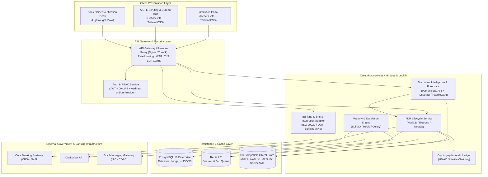
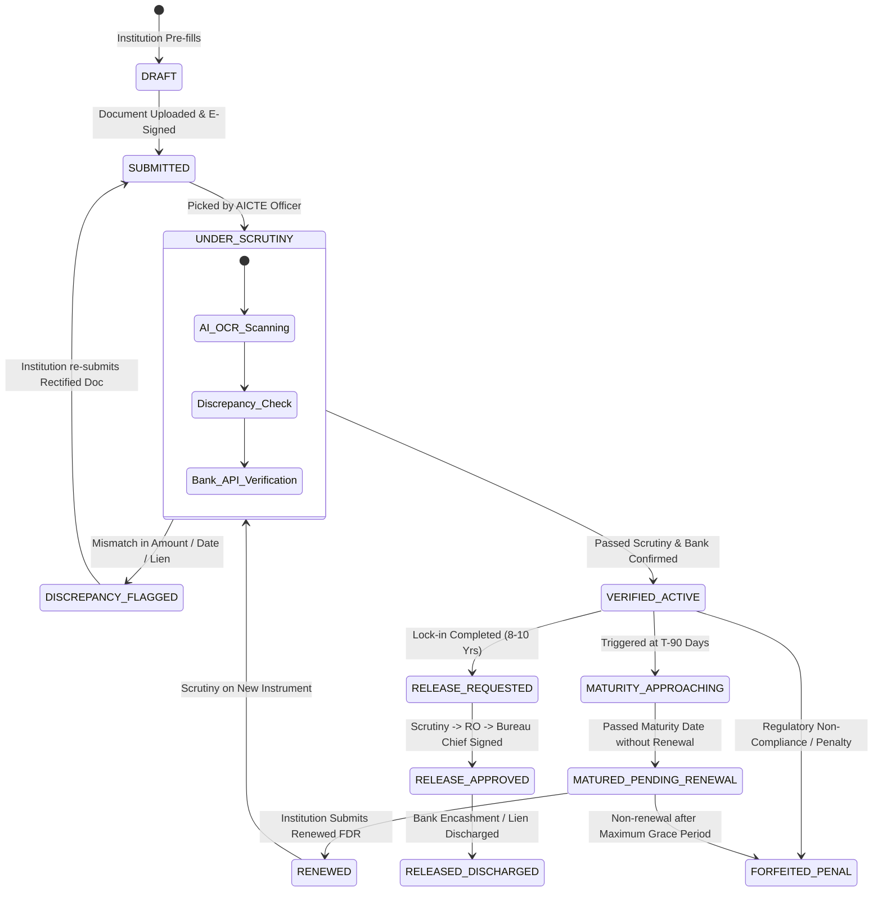
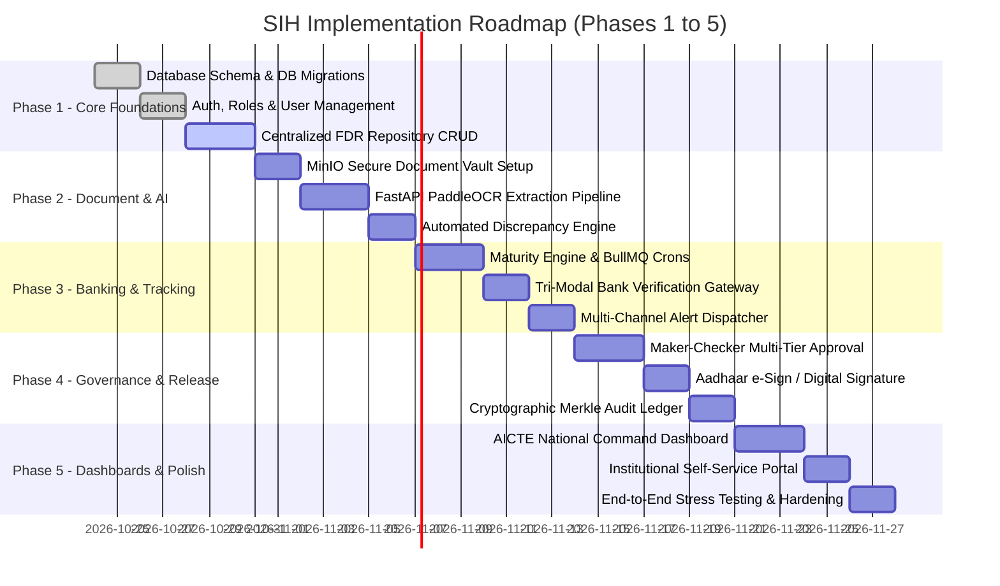

# AICTE Security Deposit & FDR Management Portal
## System Architecture & Technical Implementation Plan

> **Document Type:** Production Architecture Blueprint & Hackathon Implementation Roadmap  
> **Target System:** AICTE-FDR Portal (`GovTech / FinTech Grade`)  
> **Security Clearance:** Zero-Trust, DPDP Act 2023 & CERT-In Compliant  

---

## 1. Architectural Philosophy & Design Principles

The AICTE Security Deposit / FDR Portal is designed on five core architectural principles:
1. **Zero-Trust Security & Non-Repudiation:** Every action—from FDR upload to refund approval—is authenticated, authorized, digitally verified, and sealed in an append-only cryptographic audit chain.
2. **Dual-Truth Data Segregation:** The system strictly isolates **Self-Reported Institutional Data** from **Independently Verified Financial Data** (Bank API, SFMS, or CKYC).
3. **Automated Continuous Scrutiny:** Routine tasks (expiry tracking, OCR extraction, discrepancy detection, interest reconciliation) are automated via asynchronous worker pipelines, leaving human officials only with exception handling and statutory decision-making.
4. **State Machine Rigor:** Every financial instrument transitions through a strictly enforced Finite State Machine (FSM) where invalid state transitions are mathematically prohibited.
5. **Government-Ready Interoperability:** Clean REST/JSON APIs, OAuth2/OIDC integration with Single Sign-On (AICTE e-Governance, Jan Parichay), and DigiLocker / NeSL ready.

---

## 2. High-Level System Architecture (C4 Container Diagram)



---

## 3. Technology Stack Selection & Rationale

| Layer | Chosen Technology | Alternatives Evaluated | Engineering Justification |
| :--- | :--- | :--- | :--- |
| **Frontend Framework** | **React.js 18 + Vite + TailwindCSS** | Angular, Vue.js | Lightning-fast build times, rich enterprise component libraries (Lucide, Radix UI, TanStack Table), superior DX, lightweight bundle. |
| **Backend Core** | **Node.js (TypeScript) with Express / NestJS** | Java Spring Boot, Go | High I/O throughput for document streaming and multi-stakeholder approval queues, shared TypeScript models with frontend. |
| **AI/OCR Microservice** | **Python 3.11 with FastAPI + PaddleOCR / EasyOCR** | AWS Textract, Tesseract alone | High accuracy in recognizing Indian bank FDR formats (bilingual English/Hindi), extraction of tabular receipt dates and amounts. |
| **Primary Database** | **PostgreSQL 16** | MySQL, MongoDB | Unmatched ACID guarantees, JSONB flexibility for dynamic bank metadata, strong cryptographic extension (`pgcrypto`), mature schema migration tools. |
| **Caching & Job Queue** | **Redis 7 + BullMQ** | RabbitMQ, Celery | Ultra-low latency queue for time-based maturity monitoring, cron scheduling, and async document OCR jobs. |
| **Document Vault** | **MinIO (S3-Compatible) with Server-Side Encryption (SSE-S3)** | Local File System, MongoDB GridFS | Cloud-native, zero-lock-in, strict bucket policies, presigned URL access with expiration, SHA-256 integrity hashing. |
| **Authentication** | **OAuth2 / JWT + Role-Based Access Control (RBAC)** | Session Cookies | Stateless horizontal scaling, seamless integration with Indian National SSO (Jan Parichay) and DigiLocker Auth. |

---

## 4. Comprehensive Database Schema (PostgreSQL DDL)

The data model enforces relational integrity, instrument versioning, and immutable audit trails.

```sql
-- Enable cryptographic extensions
CREATE EXTENSION IF NOT EXISTS "uuid-ossp";
CREATE EXTENSION IF NOT EXISTS "pgcrypto";

-- Enums for strict status governance
CREATE TYPE institution_type_enum AS ENUM ('GOVERNMENT', 'GOVT_AIDED', 'PRIVATE_UNAIDED', 'DEEMED_UNIVERSITY', 'CENTRAL_UNIVERSITY');
CREATE TYPE instrument_type_enum AS ENUM ('FDR_SINGLE', 'FDR_JOINT', 'BANK_GUARANTEE', 'GOVERNMENT_SECURITIES');
CREATE TYPE fdr_status_enum AS ENUM (
    'DRAFT', 
    'SUBMITTED', 
    'UNDER_SCRUTINY', 
    'DISCREPANCY_FLAGGED', 
    'VERIFIED_ACTIVE', 
    'MATURITY_APPROACHING', 
    'MATURED_PENDING_RENEWAL', 
    'RENEWED', 
    'RELEASE_REQUESTED', 
    'RELEASE_APPROVED', 
    'RELEASED_DISCHARGED', 
    'FORFEITED_PENAL'
);
CREATE TYPE verification_source_enum AS ENUM ('SELF_DECLARED', 'OCR_EXTRACTED', 'BANK_API_VERIFIED', 'BANK_OFFICER_MANUAL', 'AICTE_RO_VERIFIED');
CREATE TYPE alert_severity_enum AS ENUM ('INFO', 'WARNING', 'CRITICAL', 'ESCALATION');

-- 1. Institutions Registry
CREATE TABLE institutions (
    id UUID PRIMARY KEY DEFAULT uuid_generate_v4(),
    pid VARCHAR(50) UNIQUE NOT NULL, -- AICTE Permanent Institute ID
    name VARCHAR(255) NOT NULL,
    type institution_type_enum NOT NULL,
    state VARCHAR(100) NOT NULL,
    regional_office VARCHAR(100) NOT NULL,
    head_of_inst_name VARCHAR(150) NOT NULL,
    head_of_inst_email VARCHAR(150) NOT NULL,
    head_of_inst_phone VARCHAR(20) NOT NULL,
    is_active BOOLEAN DEFAULT TRUE,
    created_at TIMESTAMP WITH TIME ZONE DEFAULT CURRENT_TIMESTAMP,
    updated_at TIMESTAMP WITH TIME ZONE DEFAULT CURRENT_TIMESTAMP
);

-- 2. Fixed Deposit Instruments Table
CREATE TABLE fdr_instruments (
    id UUID PRIMARY KEY DEFAULT uuid_generate_v4(),
    institution_id UUID NOT NULL REFERENCES institutions(id) ON DELETE RESTRICT,
    fdr_number VARCHAR(100) NOT NULL,
    account_number VARCHAR(100) NOT NULL,
    instrument_type instrument_type_enum DEFAULT 'FDR_JOINT',
    
    -- Financial Details
    bank_name VARCHAR(150) NOT NULL,
    branch_name VARCHAR(150) NOT NULL,
    ifsc_code VARCHAR(20) NOT NULL,
    deposit_amount NUMERIC(15, 2) NOT NULL,
    rate_of_interest NUMERIC(5, 2),
    
    -- Date Matrix
    issue_date DATE NOT NULL,
    maturity_date DATE NOT NULL,
    statutory_lock_in_years INT NOT NULL DEFAULT 8,
    statutory_lock_in_end_date DATE NOT NULL,
    
    -- Lien and AICTE Endorsement
    lien_marked BOOLEAN DEFAULT TRUE,
    lien_in_favor_of VARCHAR(255) DEFAULT 'Member Secretary, AICTE, New Delhi',
    lien_reference_number VARCHAR(100),
    
    -- Lifecycle Status
    status fdr_status_enum DEFAULT 'SUBMITTED',
    verification_level verification_source_enum DEFAULT 'SELF_DECLARED',
    is_discrepant BOOLEAN DEFAULT FALSE,
    discrepancy_notes TEXT,
    
    -- Succession lineage (for renewals)
    predecessor_fdr_id UUID REFERENCES fdr_instruments(id),
    
    created_at TIMESTAMP WITH TIME ZONE DEFAULT CURRENT_TIMESTAMP,
    updated_at TIMESTAMP WITH TIME ZONE DEFAULT CURRENT_TIMESTAMP,
    
    CONSTRAINT uq_bank_fdr UNIQUE (bank_name, fdr_number)
);

-- 3. Digital Documents & Forensic Scans
CREATE TABLE fdr_documents (
    id UUID PRIMARY KEY DEFAULT uuid_generate_v4(),
    fdr_id UUID NOT NULL REFERENCES fdr_instruments(id) ON DELETE CASCADE,
    document_type VARCHAR(50) NOT NULL, -- 'FDR_CERTIFICATE', 'BANK_LIEN_LETTER', 'BOARD_RESOLUTION', 'DISCHARGE_NOC'
    file_name VARCHAR(255) NOT NULL,
    s3_key VARCHAR(500) NOT NULL,
    mime_type VARCHAR(100) NOT NULL,
    file_size_bytes BIGINT NOT NULL,
    sha256_hash CHAR(64) NOT NULL, -- Cryptographic integrity validation
    
    -- OCR Extraction Metadata
    ocr_processed BOOLEAN DEFAULT FALSE,
    ocr_confidence_score NUMERIC(5, 2),
    ocr_extracted_payload JSONB,
    
    uploaded_by VARCHAR(100) NOT NULL,
    created_at TIMESTAMP WITH TIME ZONE DEFAULT CURRENT_TIMESTAMP
);

-- 4. Verification History & Discrepancies
CREATE TABLE fdr_verifications (
    id UUID PRIMARY KEY DEFAULT uuid_generate_v4(),
    fdr_id UUID NOT NULL REFERENCES fdr_instruments(id) ON DELETE CASCADE,
    verification_source verification_source_enum NOT NULL,
    verified_by_user VARCHAR(150),
    bank_api_transaction_ref VARCHAR(150),
    is_valid BOOLEAN NOT NULL,
    bank_confirmed_amount NUMERIC(15, 2),
    bank_confirmed_maturity DATE,
    bank_confirmed_lien BOOLEAN,
    remarks TEXT,
    raw_response_payload JSONB,
    verified_at TIMESTAMP WITH TIME ZONE DEFAULT CURRENT_TIMESTAMP
);

-- 5. Release & Refund Workflow Ledger
CREATE TABLE fdr_release_requests (
    id UUID PRIMARY KEY DEFAULT uuid_generate_v4(),
    fdr_id UUID NOT NULL REFERENCES fdr_instruments(id) ON DELETE RESTRICT,
    institution_id UUID NOT NULL REFERENCES institutions(id),
    requested_amount NUMERIC(15, 2) NOT NULL,
    reason_for_release TEXT NOT NULL,
    
    -- Workflow Stages: MAKER (Scrutiny) -> CHECKER (Regional Officer) -> AUTHORIZER (Bureau Chief)
    scrutiny_status VARCHAR(50) DEFAULT 'PENDING',
    scrutiny_by VARCHAR(150),
    scrutiny_comments TEXT,
    scrutiny_at TIMESTAMP WITH TIME ZONE,
    
    ro_recommendation VARCHAR(50) DEFAULT 'PENDING',
    ro_by VARCHAR(150),
    ro_comments TEXT,
    ro_at TIMESTAMP WITH TIME ZONE,
    
    final_authorization VARCHAR(50) DEFAULT 'PENDING',
    authorized_by VARCHAR(150),
    digital_signature_hash VARCHAR(500),
    authorized_at TIMESTAMP WITH TIME ZONE,
    
    noc_document_key VARCHAR(500),
    created_at TIMESTAMP WITH TIME ZONE DEFAULT CURRENT_TIMESTAMP
);

-- 6. Automated Alerts & Escalations
CREATE TABLE fdr_alerts (
    id UUID PRIMARY KEY DEFAULT uuid_generate_v4(),
    fdr_id UUID REFERENCES fdr_instruments(id) ON DELETE CASCADE,
    institution_id UUID REFERENCES institutions(id),
    severity alert_severity_enum NOT NULL,
    alert_code VARCHAR(50) NOT NULL, -- 'EXPIRY_90_DAYS', 'OVERDUE_RENEWAL', 'DISCREPANCY_FOUND'
    message TEXT NOT NULL,
    channels_sent VARCHAR(50)[] NOT NULL, -- {'SMS', 'EMAIL', 'PORTAL'}
    is_read BOOLEAN DEFAULT FALSE,
    is_resolved BOOLEAN DEFAULT FALSE,
    escalation_tier INT DEFAULT 1, -- 1: College, 2: Regional Officer, 3: Bureau Head
    created_at TIMESTAMP WITH TIME ZONE DEFAULT CURRENT_TIMESTAMP
);

-- 7. Tamper-Evident Immutable Audit Log
CREATE TABLE audit_ledger (
    id BIGSERIAL PRIMARY KEY,
    entity_name VARCHAR(50) NOT NULL,
    entity_id UUID NOT NULL,
    action_type VARCHAR(50) NOT NULL, -- 'INSERT', 'UPDATE', 'VERIFY', 'APPROVE_RELEASE', 'OVERRIDE'
    actor_id VARCHAR(100) NOT NULL,
    actor_role VARCHAR(50) NOT NULL,
    actor_ip VARCHAR(50) NOT NULL,
    previous_state JSONB,
    new_state JSONB,
    prev_record_hash CHAR(64), -- Merkle-style blockchain link
    record_hash CHAR(64) NOT NULL, -- SHA256(id + entity_id + action + new_state + prev_record_hash)
    created_at TIMESTAMP WITH TIME ZONE DEFAULT CURRENT_TIMESTAMP
);

-- Create indexes for performance
CREATE INDEX idx_fdr_institution ON fdr_instruments(institution_id);
CREATE INDEX idx_fdr_maturity ON fdr_instruments(maturity_date);
CREATE INDEX idx_fdr_status ON fdr_instruments(status);
CREATE INDEX idx_fdr_bank_acc ON fdr_instruments(bank_name, account_number);
CREATE INDEX idx_alerts_unresolved ON fdr_alerts(is_resolved, severity);
CREATE INDEX idx_audit_entity ON audit_ledger(entity_name, entity_id);
```

---

## 5. FDR Lifecycle Finite State Machine (FSM)



---

## 6. Document Forensics & AI/OCR Scrutiny Pipeline

### 6.1 Computer Vision & Extraction Architecture
When an institution uploads an FDR scan (PDF/PNG/JPG):
1. **Preprocessing:** Image deskewing, noise filtering, and thresholding using OpenCV.
2. **Layout & Text Detection:** PaddleOCR / LayoutLM extracts bounding boxes and text blocks.
3. **Named Entity Recognition (NER) & Regex Heuristics:**
   - Extract FDR Number (`(?i)(?:FDR|Fixed\s*Deposit|Receipt)\s*No[:.\s]*([A-Z0-9\/-]+)`)
   - Extract Deposit Amount (`(?i)(?:Rs\.?|INR)\s*([\d,]+\.?\d*)`)
   - Extract Issue & Maturity Dates (`\b\d{1,2}[-\/.]\d{1,2}[-\/.]\d{2,4}\b`)
   - Extract IFSC (`^[A-Z]{4}0[A-Z0-9]{6}$`)
4. **Discrepancy Scoring Function:**
   $$\Delta_{score} = w_1 \cdot \text{Levenshtein}(FDR_{input}, FDR_{ocr}) + w_2 \cdot \frac{|Amt_{input} - Amt_{ocr}|}{Amt_{input}} + w_3 \cdot \mathbb{I}(Date_{diff} > 0)$$
   If $\Delta_{score} > 0.05$, the system automatically marks `is_discrepant = TRUE` and highlights mismatched fields in red on the Scrutiny Screen.

---

## 7. Banking Verification Gateway & NeSL Simulator

To accommodate Indian Banking Systems without requiring instant live production APIs during hackathon evaluation, the platform implements a **Tri-Modal Bank Verification Architecture**:

```
+---------------------------------------------------------------------------------+
|                         TRI-MODAL VERIFICATION ADAPTER                          |
+---------------------------------------------------------------------------------+
| Mode 1: Real-Time Open Banking API / SFMS Mock Gateway                          |
|         Simulates Core Banking System (CBS) endpoints (SBI, PNB, HDFC, Canara). |
|         Input: { bank_code, fdr_number, ifsc, date_of_deposit }                 |
|         Output: { is_lien_marked: true, live_balance: 5000000, status: "ACTIVE"}|
+---------------------------------------------------------------------------------+
| Mode 2: Bank Official Portal / Digital Verification Token                       |
|         Generates secure, one-time signed verification link sent to the Branch  |
|         Manager's verified bank domain email (@sbi.co.in). Branch Manager clicks|
|         and confirms lien status with digital certificate / OTP.               |
+---------------------------------------------------------------------------------+
| Mode 3: NeSL / DigiLocker Information Utility Verification                      |
|         Validates against e-Stamping and Digital Document Execution (DDE).      |
+---------------------------------------------------------------------------------+
```

---

## 8. Step-by-Step Implementation Roadmap (Hackathon to Production)



---

## 9. Security, Compliance & Disaster Recovery

1. **Encryption Standards:**
   - At Rest: AES-256 for MinIO objects and PostgreSQL volume encryption.
   - In Transit: TLS 1.3 with HSTS enabled.
   - Sensitive Columns: Account numbers and IFSC encrypted using `pgp_sym_encrypt`.
2. **Access Security:**
   - Role-Based Access Control (RBAC) enforced at API Gateway and database row-level security (RLS).
   - Zero hardcoded secrets: HashiCorp Vault / Doppler configuration injection.
3. **Immutable Audit Trail:**
   - Every ledger row contains `record_hash = SHA256(payload + previous_hash)`. Any out-of-band database tampering instantly invalidates the cryptographic chain.
4. **Data Privacy (DPDP 2023):**
   - Personal identification data (Bank Manager phone numbers, Institution Head contact) masked in non-administrative view screens.
