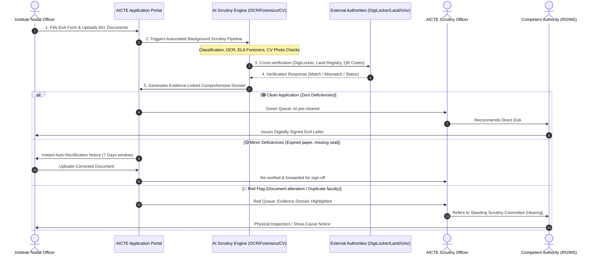

# AICTE EoA & Approval Scrutiny Platform: Problem Statement Explained in Pure Hinglish

> **Bhai, chill maaro aur dhyan se suno!**  
> Yeh guide Smart India Hackathon (SIH) ke AICTE approval aur scrutiny problem statement ka **sabse detailed, practical aur mazedaar breakdown** hai. Isko shuru se ant tak padh lo — tumhare dimag mein problem ka har ek kona, technical pipeline, aur judges ko pitch karne ka solid vision bilkul crystal clear ho jayega!

---

## Index (Is Guide Mein Hum Kya Samjhenge?)

1. [Asal Kahaani: AICTE, APH aur "Extension of Approval (EoA)" kya hota hai?](#1-asal-kahaani-aicte-aph-aur-extension-of-approval-eoa-kya-hota-hai)
2. [Real-World Bottleneck: Scrutiny Process mein abhi kya aag lagi hui hai?](#2-real-world-bottleneck-scrutiny-process-mein-abhi-kya-aag-lagi-hui-hai)
3. [Colleges Kaise Chalaaki/Fraud Karte Hain? (Real Scenarios)](#3-colleges-kaise-chalaakifraud-karte-hain-real-scenarios)
4. [Humein (Developers ko) Kya Solution Banana Hai?](#4-humein-developers-ko-kya-solution-banana-hai)
5. [Problem Statement Ke 5 Main Pillars (Deep Dive)](#5-problem-statement-ke-5-main-pillars-deep-dive)
   - Pillar 1: Intelligent Application & Document Validation (OCR + DB Sync)
   - Pillar 2: Anomaly & Document Forgery Detection (AI Forensics)
   - Pillar 3: Issuing Authority Direct Verification (APIs, QR, DigiLocker)
   - Pillar 4: Regulatory & Infrastructure Compliance (Computer Vision & Rule Engine)
   - Pillar 5: Decision-Support Dashboard & Audit Trail (Human-in-the-Loop)
6. [Portal Ke 5 Main Characters (User Roles)](#6-portal-ke-5-main-characters-user-roles)
7. [Ek Application Ki Zindagi: Day 1 Submission se EoA Grant Tak](#7-ek-application-ki-zindagi-day-1-submission-se-eoa-grant-tak)
8. [Essential Safeguards: AI Judge Nahi Hai, Babu Sahab Hi Decision Lenge!](#8-essential-safeguards-ai-judge-nahi-hai-babu-sahab-hi-decision-lenge)
9. [Hackathon Grand Finale: Judges Ko Impress Karne Waale "Secret Sauces" (UVP)](#9-hackathon-grand-finale-judges-ko-impress-karne-waale-secret-sauces-uvp)
10. [1-Minute Quick Recap (Pitch & Viva Cheat Sheet)](#10-1-minute-quick-recap-pitch--viva-cheat-sheet)

---

## 1. Asal Kahaani: AICTE, APH aur "Extension of Approval (EoA)" kya hota hai?

### AICTE Kaun Hai?
**All India Council for Technical Education (AICTE)** Bharat Sarkar (Ministry of Education) ki statutory body hai. India ke saare Engineering colleges (B.Tech/M.Tech), Management institutes (MBA/PGDM), Pharmacy colleges, Architecture aur Polytechnic diplomas tabhi chal sakte hain jab AICTE unko **Approval (Manzoori)** de.

### APH (Approval Process Handbook) Kya Hai?
Har saal AICTE ek moti rulebook nikaalti hai jisko bolte hain **Approval Process Handbook (APH)**. Is book mein pathar ki lakeer waale rules hote hain:
- Ek college mein kitni zameen honi chahiye (Urban area mein 1.5 Acre, Rural mein 4-7.5 Acre).
- Har 20 students par kitne faculty hone chahiye (Student-Faculty Ratio: 1:20 for B.Tech, 1:15 for PG).
- Computer lab mein kitne computers hone chahiye, library mein kitni books honi chahiye.
- Fire Safety Certificate, Land Title Deed, Society Registration, Pollution NOC, Building Stability Certificate up-to-date hone chahiye.

### EoA (Extension of Approval) Kya Hota Hai?
Agar kisi college ko pichle saal permission mili thi, toh iska matlab yeh nahi ki woh agle 50 saal tak aish karega!  
**Har saal college ko AICTE se "Renewal" lena padta hai**, jise technical bhasha mein **Extension of Approval (EoA)** kehte hain.  
College ko prove karna padta hai:
> *"Hum abhi bhi saare rules follow kar rahe hain, teachers ko salary de rahe hain, labs chal rahi hain, aur building surakshit hai."*

---

## 2. Real-World Bottleneck: Scrutiny Process mein abhi kya aag lagi hui hai?

Socho: India mein lagbhag **10,000+ approved institutions** hain.  
Har college EoA ya naye courses ke liye apply karta hai aur application ke saath **50 se 100 alag-alag documents** upload karta hai:
- Land documents (Khasra/Khatauni, Registry deeds, Non-encumbrance certificate)
- Building Completion Certificate & Approved Floor Plans (signed by Town Planner/Architect)
- Fire Safety NOC (issued by State Fire Department)
- Pollution Control Board Certificate
- University Affiliation Letter & State Government NOC
- Faculty List, Aadhaar/PAN, Qualification Degrees, Bank Salary Statements
- Lab Equipment purchase bills and geotagged lab photos
- TER (Technical Education Regulatory) charges payment receipts

### Abhi Problem Kya Hai? (The Human Nightmare)
1. **Pahaad Jaisi Files (Data Overload):** AICTE ke Scrutiny Officers (babu log ya deputed professors) ko har saal **5 se 10 Lakh documents** physically ya PDF khoorkar check karne padte hain.
2. **Human Fatigue (Aankhon Mein Dard, Dimaag Out):** Ek officer roz 40-50 colleges ke 100-page ke PDFs check karte-karte thak jaata hai. Chhoti-moti par critical galtiyan (jaise expired NOC ya mismatched survey number) chhoot jaati hain.
3. **Fake & Manipulated Papers:** Chalaak colleges expired NOC par Photoshop se date change kar dete hain, ya kisi doosre college ke computer lab ki photo internet se download karke upload kar dete hain!
4. **Third-Party Verification Impossible:** Fire NOC sach mein Fire Department ne di hai ya college ne market se fake banwayi hai? AICTE officer ke paas roz 100 departments ko letter bhejkar wait karne ka waqt nahi hota.
5. **Regulatory Delay:** Pure process mein mahinon lag jaate hain, naya academic session shuru hone wala hota hai, admissions delay hote hain, aur courts mein case chale jaate hain.

---

## 3. Colleges Kaise Chalaaki/Fraud Karte Hain? (Real Scenarios)

Judges ke saamne jab tum yeh real fraud scenarios bologe, toh unko turant samajh aayega ki tumne ground reality study ki hai:

| S.No. | Fraud/Chalaaki Ka Tareeka | Asal Zindagi Ka Example | AI Platform Kaise Pakdega? |
|---|---|---|---|
| 1 | **Date Tampering (Photoshop)** | Fire Safety NOC 2022 mein expire ho gayi thi. College ne PDF editor mein '2022' ko '2027' kar diya. | **Error Level Analysis (ELA) + Font Metadata Analysis** pakad lega ki us area mein JPEG compression alag hai aur font vector match nahi ho raha. |
| 2 | **Ghost Faculty (Duplicate Teachers)** | Ek hi PhD professor "Dr. Sharma" Jaipur ke bhi college mein full-time HOD bane hue hain aur Kota ke bhi college mein enrolled hain! | **Cross-Institutional AICTE Database Deduplication** turant alert dega: *"Dr. Sharma's PAN/Aadhaar hash is already mapped to College ID 1-45678!"* |
| 3 | **Fake Lab Photos (Infrastructure Fraud)** | College ne naya CSE course manga jiske liye 60 computers chahiye. Unke paas bas 15 the, toh unhone stock image ya purani photo multiple angles se daal di. | **Computer Vision (YOLO/Object Detection) + Reverse Image Search** count karega kitne monitors/CPUs hain aur check karega metadata/EXIF coordinates. |
| 4 | **Land & Built-up Area Mismatch** | Form mein likha *"Total Built-up Area: 10,000 sq.m"*, lekin architect ke blueprint drawing ke text table mein sum sirf *7,200 sq.m* banta hai! | **OCR + Regex Table Extraction** blueprint ke tables ko calculate karega aur form ke claim se tally karega. Mismatch = Red Flag! |
| 5 | **Fake University NOC (Signature Copy-Paste)** | University Registrar ke signature ko purane letter se crop karke naye NOC letterhead par chipka diya. | **Digital Signature Certificate (DSC) Validator + Seal Edge Detection** verify karega ki DSC cryptographic token hai ya dead raster image. |

---

## 4. Humein (Developers ko) Kya Solution Banana Hai?

AICTE ko ek **"AI-Powered Integrated Decision-Support & Scrutiny Platform"** chahiye.

Iska seedha matlab:
> **"Application aate hi AI pehle 30 seconds mein saari files ko scan kare, external portals se verify kare, manipulation dhoonde, aur officer ke saamne ek transparent 'Deficiency & Evidence Dashboard' rakh de — taaki officer ko bas final decision lene mein 5 minute lagein, 5 ghante nahi!"**

---

## 5. Problem Statement Ke 5 Main Pillars (Deep Dive)

### 🔹 PILLAR 1: Intelligent Application & Document Validation
*AI Document Reader & Checker*
- **Application Category Identification:** Pehle pehchano application kis cheez ki hai:
  - *Extension of Approval (EoA) regular*
  - *Increase in Intake (Seat badhana)*
  - *New Course / Program addition*
  - *Closure of Course / Institute*
  - *Change of Site / Location*
- **Dynamic Checklist Generation:** Har category ke liye alag checklist hoti hai. System turant rules load karega ki is college ko kaun-kaun se 25 documents jama karne the.
- **Smart OCR & Multi-lingual NER:** English aur Hindi/State languages mein likhe documents se OCR (Tesseract/PaddleOCR/AWS Textract) dwara key fields extract karna:
  - Trust Name, College Name, Survey/Khasra Number, Issuing Officer, Issue Date, Expiry Date.
- **Cross-Record Validation:** Jo details college ne form ke input boxes mein bhari hain (e.g., Land Area = 5.2 Acres), kya wahi same number uploaded Khasra document ke andar likha hai? Agar form mein 5.2 hai aur paper mein 3.2 hai — turant **Yellow Alert**!

---

### 🔹 PILLAR 2: Anomaly & Potential Forgery Detection (AI Forensics)
*AI Detective: Nakli aur Tampered Kagaz Pakadne Wala*
- **Error Level Analysis (ELA):** Jab kisi digital image/PDF mein text edit ya paste hota hai, toh edited hisse ka compression error level baaki page se alag hota hai. ELA heatmap par tampered text chamakne lagta hai!
- **Metadata Forensics:** PDF ka creation date, modification software (e.g., Photoshop, Canva, iLovePDF) aur author metadata check karna.
- **Font & Glyph Inconsistency:** Ek hi paragraph mein alag DPI ya alag font family ka pata lagana (e.g., date ka font thoda rotated ya blur hona).
- **Duplicate Document Detection:** Kya pichle saal kisi aur college ne yahi exact electricity bill ya fire NOC submit kiya tha? Perceptual Hashing (pHash) aur embedding matching se duplicate pakadna.
- **Explainable Anomaly Card:** System sirf yeh nahi bolega "Suspicious". Woh reason batayega:
  > *"Alert: Issue Date '15/08/2025' overlaps on existing text layer with higher compression artifact (Confidence: 89%). Human inspection advised."*

---

### 🔹 PILLAR 3: Verification Through Original Issuing Authorities
*Seedha Source Se Sach Pata Karo (Direct API & Digital Trust)*
AICTE chahta hai ki jahan possible ho, middleman ko hata kar original authority se direct cross-check ho:
1. **DigiLocker / National Academic Depository (NAD):**
   - Faculty ke degree certificates DigiLocker API se direct verify karo.
2. **State Land Records Registry (Bhulekh / Meebhoomi / AnyRoR):**
   - Khasra/Khatauni number ko state land portal API se ping karke confirm karo ki zameen sach mein trust ke naam registered hai ya kisi kisaan ki zameen ka fake paper hai.
3. **QR Code & Barcode Decryption:**
   - Modern Fire NOCs aur Municipal Certificates par QR code hota hai. System QR code scan karke official URL se cryptographic payload match karega.
4. **Digital Signature (DSC / PAdES) Verification:**
   - PDF ke andar embedded X.509 digital certificates ko check karna (Valid, Revoked, Expired, Self-signed).
5. **Status Categorization:**
   - `VERIFIED_AUTHORITATIVE` (Direct API match)
   - `MISMATCH_DETECTED` (Authority returned different data)
   - `EXPIRED` (Certificate validity ended)
   - `SOURCE_UNAVAILABLE` (Government server down, retry queued)
   - `MANUAL_REVIEW_REQUIRED` (Document has no API, officer must review)

---

### 🔹 PILLAR 4: Regulatory & Infrastructure Compliance Assistance
*Approval Process Handbook (APH) Rules Engine + Computer Vision*
- **Configurable Regulatory Rule Engine:** Rules hardcode nahi honge! Har saal AICTE handbook change karta hai. Isliye Admin portal par ek rule engine hoga (e.g. JSON-rules / Drools):
  ```json
  {
    "program": "Engineering_UG",
    "required_cadre_ratio": "1:2:6", // 1 Professor, 2 Associate, 6 Assistant
    "faculty_student_ratio": "1:20",
    "min_land_urban_acres": 1.5,
    "min_built_up_area_per_student": 4.5
  }
  ```
- **Cadre Ratio & Faculty Eligibility Scrutinizer:**
  - System check karega: Kya HOD ke paas PhD hai? Kya required ratio follow ho raha hai?
- **Computer Vision Infrastructure Checker:**
  - **Lab & Classroom Verification:** Object detection model (YOLOv8) photo mein count karega: Number of PC monitors, Fire Extinguishers, First Aid Kits, Projector screens.
  - **Geo-Tag & EXIF Validation:** Photo kab aur kahan li gayi? Latitude/Longitude coordinates college ke approved campus boundary ke andar hain ya 50 km door kisi cafe ki photo hai?

---

### 🔹 PILLAR 5: Validation Dashboard, Alerts and Audit Trail
*Officer Ka Cockpit & Legal Security*
- **Traffic Light Scrutiny Index:**
  - 🟢 **Green (Clean Pass):** Saare documents valid, issuing authority verified, rules 100% compliant. Quick 1-click EoA clearance.
  - 🟡 **Yellow (Deficiency / Minor Gap):** Ek document expired hai ya ek faculty ka certificate missing hai. System auto-generates a **Rectification Notice** to the institute with a 7-day timer.
  - 🔴 **Red (Critical Anomaly / Suspected Manipulation):** Altered date, fake land deed, duplicate faculty. Routed to Special Scrutiny Committee for physical hearing.
- **Evidence-Linked Findings:** Officer dashboard par click karega toh screen par split-view aayega:
  - *Left Side:* Extracted data and anomaly alert.
  - *Right Side:* Original PDF with the exact bounding box highlighted in red!
- **Tamper-Proof Audit Trail:**
  - Har action log hoga: Kis AI model ne kab scan kiya, kis officer ne kab approve kiya, kya remarks dale gaye.

---

## 6. Portal Ke 5 Main Characters (User Roles)

```
+-----------------------------------------------------------------------------------------+
|                                    USER ROLES IN PORTAL                                 |
+-----------------------------------------------------------------------------------------+

  1. INSTITUTION NODAL OFFICER (College Principal / Registrar)
     - Application bharta hai, documents aur photos upload karta hai.
     - Preliminary AI scan report dekhkar submit karne se pehle galtiyan theek kar sakta hai.

  2. AICTE SCRUTINY OFFICER (Regional Directorate / Desk Officer)
     - AI dashboard par categorized applications dekhta hai.
     - Evidence-linked flags ko review karke observations record karta hai.
     - Rectification notice issue karta hai ya approve karta hai.

  3. STANDING SCRUTINY COMMITTEE / HEARING COMMITTEE (Expert Panel)
     - Yellow/Red flagged complex cases ki physical/virtual hearing conduct karta hai.
     - Discrepancy evidence ko review karke statutory recommendation deta hai.

  4. COMPETENT AUTHORITY (Regional Officer / Member Secretary AICTE)
     - Final legal signing authority jo EoA grant, rejection ya penalty ka order deta hai.

  5. SYSTEM & REGULATORY ADMIN (AICTE HQ Tech Team)
     - Har saal naye Approval Process Handbook (APH) ke hisaab se checklists aur rules update karta hai.
     - Issuing authority API keys aur weights configure karta hai.
```

---

## 7. Ek Application Ki Zindagi: Day 1 Submission se EoA Grant Tak



---

## 8. Essential Safeguards: AI Judge Nahi Hai, Babu Sahab Hi Decision Lenge!

Problem statement mein AICTE ne ek **bahut strict safeguard** likha hai:
> *"AI-generated findings must be treated as preliminary indicators requiring human verification, not as conclusive proof of forgery or misconduct... Retaining regulatory scrutiny and final decision-making with the competent AICTE authorities."*

### Iska Matlab (Judges ke saamne zaroor bolna):
1. **AI Decision-Support System hai, Decision-Maker nahi:** AI kabhi bhi kisi college ka approval automatically cancel nahi karega! AI bas ek digital x-ray machine hai jo fracture dikhata hai, operation doctor (AICTE officer) hi karega.
2. **Explainable AI (No Black-Box):** System yeh nahi bolega "Accuracy 94%, Reject kar do". System kahega: *"Page 3, Line 12 ke Fire Safety Certificate ki validity date '31-03-2023' extract hui hai, jo ki expired hai. Yahan dekhiye original paper."*
3. **Right to Rectification (Fair Opportunity):** Agar college ne galti se galat file upload kar di, toh unko turant opportunity milegi file theek karne ki, jab tak legal provisions allow karein.
4. **Data Privacy & Security (DPDP Act 2023):** Saare documents encrypted rahenge (AES-256), faculty ke Aadhaar mask honge (first 8 digits hidden), aur har click ka immutable audit log maintain hoga.

---

## 9. Hackathon Grand Finale: Judges Ko Impress Karne Waale "Secret Sauces" (UVP)

Agar tum normal OCR aur login page banaoge, toh average marks milenge.  
**Agar yeh 5 features dikhaoge, toh Grand Finale win pakka hai:**

###  Secret Sauce 1: Real-time "Pre-Submission AI Health Check" for Colleges
College jab apply kar raha ho, submit button dabane se pehle hi ek live AI scrubber chal jaye jo bata de:
> *"Bhai, tumne jo Architect Certificate lagaya hai usme seal blur hai aur Faculty ratio 1:22 ban raha hai jo 1:20 hona chahiye. Abhi theek kar lo warna AICTE reject kar dega!"*  
Yeh feature AICTE ke paas aane wale 70% junk applications ko source par hi filter kar dega!

###  Secret Sauce 2: Multi-Modal Document Forensics (ELA Heatmap + Font Vector Diff)
Demo screen par ek tampered PDF upload karo jisme date change ki ho.  
Jaise hi scan run ho, side-by-side viewer mein **Error Level Analysis (ELA) heatmap** red color mein glow kare aur font bounding box zoom ho jaye. Judges ki aankhein khuli reh jayengi!

###  Secret Sauce 3: Computer Vision Geo-Spatial Campus Verification
Photo upload hote hi:
1. EXIF GPS coordinates nikaalo.
2. Google Maps / OpenStreetMap API se verify karo ki photo usi campus ke latitude-longitude se click hui hai ya nahi.
3. YOLO model se lab ke computers aur equipment identify karke live tally sheet generate karo.

###  Secret Sauce 4: Cross-College Faculty Deduplication Engine
Ek mock database banao jisme 2 colleges hon. College A mein Dr. Ramesh HOD hain. College B mein Dr. Ramesh ko Associate Professor upload karo. System turant flash kare:
> *"FRAUD ALERT: Dr. Ramesh (PAN: ABCDE1234F) is already actively registered at Delhi Institute of Technology!"*

###  Secret Sauce 5: Configurable APH Rule Builder (Zero-Code)
Admin panel par ek visually stunning drag-and-drop rule builder dikhao jahan AICTE officer bina kisi programmer ke 2026-27 ke naye rules (jaise AI courses ke liye nayi lab requirements) 2 minute mein update kar sake!

---

## 10. 1-Minute Quick Recap (Pitch & Viva Cheat Sheet)

- **Problem:** AICTE ko har saal 10,000+ technical colleges ke Extension of Approval (EoA) ke dauraan 5-10 lakh documents manually check karne padte hain, jisme human error, fake documents, ghost faculty aur heavy delay hota hai.
- **Solution:** AI-powered Decision Support & Scrutiny Platform jo application category ke hisaab se dynamic checklists banata hai, OCR se data extract karta hai, AI forensics se document tampering pakadta hai, DigiLocker/APIs se direct verify karta hai, aur Computer Vision se lab infrastructure tally karta hai.
- **Key Safety Guardrail:** Human-in-the-Loop. AI sirf advisory evidence dossier banata hai, final statutory decision hamesha AICTE ke competent officers ke paas rehta hai.
- **Core Impact:** Scrutiny time 3-4 hafte se ghat kar **30 seconds preliminary + 5 minutes human review** ho jayega! Transparency 100%, fake colleges zero!
