# AICTE EoA & Approval Scrutiny Platform: Technical Architecture & Implementation Plan

> **System Designation:** AICTE Automated Regulatory Scrutiny & Document Intelligence Platform (AICTE-ARSDIP)  
> **Deployment Target:** Cloud / NIC / MeghRaj Data Centre compliant  
> **Architecture Style:** Event-Driven Microservices / Asynchronous Processing Pipeline  

---

## 1. High-Level Architectural Blueprint

The platform is designed around a **Zero-Trust, Human-in-the-Loop Decision Support Pipeline**. The core architecture decouples high-throughput document ingestion from compute-intensive AI inference (OCR, forensic image processing, computer vision) and external authority API queries.

```mermaid
flowchart TB
    subgraph UI_Layer [Client & Presentation Layer]
        A1[Institute Portal: Pre-Submission Check]
        A2[Scrutiny Officer Cockpit: Split-Screen Dossier]
        A3[Regional Officer Approval Portal]
        A4[System Admin: APH Rule Engine Builder]
    end

    subgraph Gateway_Layer [API Gateway & Security]
        B1[Reverse Proxy / Kong / Nginx Gateway]
        B2[OAuth2 / Keycloak RBAC & JWT Validator]
        B3[Rate Limiting & WAF Shield]
    end

    subgraph Core_Services [Application Core Services]
        C1[Application Ingestion Service]
        C2[Regulatory Rule Engine & Checklist Generator]
        C3[Scrutiny Workflow & State Orchestrator]
        C4[Audit Trail & Event Log Service]
        C5[Notification & Defect Rectification Service]
    end

    subgraph Message_Broker [Asynchronous Queue & Event Bus]
        D1[(Kafka / Redis Streams: Scrutiny Task Pipeline)]
    end

    subgraph AI_Intelligence_Cluster [AI & Forensic Inference Cluster]
        E1[Document Normalization & Layout-Parser]
        E2[OCR Engine: Tesseract / PaddleOCR / EasyOCR]
        E3[Document Forensics Engine: ELA & Metadata Forensics]
        E4[Computer Vision Engine: YOLOv8 Lab & Geotag Scrutinizer]
        E5[Cross-Doc & Cross-College Deduplication Engine]
    end

    subgraph Verification_Gateway [Issuing Authority Connectors]
        F1[DigiLocker / NAD Academic Verification Adapter]
        F2[State Land Registry API Connectors]
        F3[QR Code Decryption & Cryptographic Validator]
        F4[PAdES / X.509 Digital Signature Validator]
    end

    subgraph Data_Persistence [Data Persistence Layer]
        G1[(PostgreSQL: Relational App, Scrutiny & Checklist DB)]
        G2[(MinIO / S3: Encrypted Document Object Store)]
        G3[(Qdrant / Milvus: Visual & Text Feature Vector DB)]
        G4[(Redis: Fast Cache & Session Store)]
    end

    UI_Layer --> Gateway_Layer
    Gateway_Layer --> Core_Services
    Core_Services --> Message_Broker
    Message_Broker --> AI_Intelligence_Cluster
    Message_Broker --> Verification_Gateway
    Core_Services --> Data_Persistence
    AI_Intelligence_Cluster --> Data_Persistence
    Verification_Gateway --> Core_Services
```



---

## 2. Document Processing & Scrutiny Pipeline

The ingestion and validation flow processes multi-page PDF documents and high-resolution raster images through an asynchronous 5-stage pipeline:

```
[Uploaded Document (PDF / Image)]
               │
               ▼
   [Stage 1: Ingestion & Integrity Check]
   - Compute SHA-256 Checksum
   - Antivirus & MIME-type Sanity
   - Store encrypted payload in MinIO / S3
               │
               ▼
   [Stage 2: Document Pre-processing & Layout Analysis]
   - PDF rasterization into 300 DPI high-contrast images
   - Page deskewing, binarization, noise filtering
   - LayoutLMv3 semantic bounding box segmentation
               │
               ▼
   [Stage 3: Multi-Modal Extraction & Forensics]
   ┌────────────────────────────────────────┴────────────────────────────────────────┐
   ▼                                                 ▼                               ▼
[OCR & NER Extraction]                      [Forensic Tamper Detection]       [External Verification]
- Extract Land survey numbers               - Error Level Analysis (ELA)       - DigiLocker Degree API
- Extract Fire NOC dates                    - PDF Metadata chain audit         - Land Records Gateway
- Extract Faculty PAN / Aadhaar hashes      - Font & edge gradient audit      - QR Code Payload Check
- Extract Cadre designations                - Visual pHash deduplication       - DSC Certificate chain
   └────────────────────────────────────────┬────────────────────────────────────────┘
               │
               ▼
   [Stage 4: Regulatory Rule Engine Cross-Check]
   - Tally against Approval Process Handbook (APH) metrics
   - Student-to-Faculty Ratio (1:20 UG Engineering, 1:15 PG)
   - Cadre Ratio verification (1:2:6 Professor:Associate:Assistant)
   - Minimum Land & Built-up Area calculation
               │
               ▼
   [Stage 5: Evidence Dossier & Scrutiny Dashboard Generation]
   - Synthesize Verification Matrix (Verified, Mismatch, Expired, Anomaly)
   - Generate split-screen interactive review payload
   - Emit automated Rectification Notice if deficiencies detected
```

---

## 3. Database Schema Design (PostgreSQL)

### 3.1 Institutions & Applications
```sql
CREATE TABLE institutions (
    id UUID PRIMARY KEY DEFAULT gen_random_uuid(),
    aicte_permanent_id VARCHAR(50) UNIQUE NOT NULL,
    institution_name VARCHAR(255) NOT NULL,
    trust_name VARCHAR(255) NOT NULL,
    institution_type VARCHAR(50) NOT NULL, -- Affiliated, Autonomous, Deemed, University
    region VARCHAR(50) NOT NULL, -- Northern, Western, Southern, etc.
    state VARCHAR(100) NOT NULL,
    district VARCHAR(100) NOT NULL,
    urban_rural_status VARCHAR(20) NOT NULL, -- Urban, Rural, Metro
    campus_latitude NUMERIC(10, 7),
    campus_longitude NUMERIC(10, 7),
    created_at TIMESTAMP WITH TIME ZONE DEFAULT CURRENT_TIMESTAMP
);

CREATE TABLE applications (
    id UUID PRIMARY KEY DEFAULT gen_random_uuid(),
    institution_id UUID REFERENCES institutions(id) ON DELETE CASCADE,
    academic_year VARCHAR(10) NOT NULL, -- e.g. "2026-2027"
    application_category VARCHAR(100) NOT NULL, -- EoA, New_Course, Increase_Intake, Change_Site
    current_status VARCHAR(50) DEFAULT 'DRAFT', 
    -- DRAFT, PRE_SUBMITTED, UNDER_SCRUTINY, DEFICIENCY_ISSUED, HEARING_SCHEDULED, APPROVED, REJECTED
    total_documents_count INT DEFAULT 0,
    ai_scrutiny_status VARCHAR(50) DEFAULT 'NOT_STARTED', -- PENDING, IN_PROGRESS, COMPLETED
    ai_risk_score NUMERIC(5, 2) DEFAULT 0.00, -- 0.00 (Clean) to 100.00 (High Risk)
    scrutiny_officer_id UUID,
    submitted_at TIMESTAMP WITH TIME ZONE,
    scrutiny_completed_at TIMESTAMP WITH TIME ZONE
);
```

### 3.2 Documents, Forensic Findings & Extracted Entities
```sql
CREATE TABLE application_documents (
    id UUID PRIMARY KEY DEFAULT gen_random_uuid(),
    application_id UUID REFERENCES applications(id) ON DELETE CASCADE,
    document_category VARCHAR(100) NOT NULL, 
    -- LAND_TITLE, BUILDING_PLAN, FIRE_SAFETY_NOC, FACULTY_LIST, UNIVERSITY_AFFILIATION, LAB_PHOTOS
    file_name VARCHAR(255) NOT NULL,
    s3_storage_uri TEXT NOT NULL,
    sha256_hash CHAR(64) NOT NULL,
    perceptual_hash VARCHAR(64),
    mime_type VARCHAR(50) NOT NULL,
    file_size_bytes BIGINT NOT NULL,
    upload_timestamp TIMESTAMP WITH TIME ZONE DEFAULT CURRENT_TIMESTAMP
);

CREATE TABLE document_extracted_entities (
    id UUID PRIMARY KEY DEFAULT gen_random_uuid(),
    document_id UUID REFERENCES application_documents(id) ON DELETE CASCADE,
    entity_key VARCHAR(100) NOT NULL, -- survey_no, issue_date, expiry_date, built_up_area, issuing_authority
    raw_extracted_value TEXT NOT NULL,
    normalized_value TEXT,
    confidence_score NUMERIC(5, 4), -- 0.0000 to 1.0000
    page_number INT,
    bounding_box_json JSONB -- {x1, y1, x2, y2}
);

CREATE TABLE forensic_anomalies (
    id UUID PRIMARY KEY DEFAULT gen_random_uuid(),
    document_id UUID REFERENCES application_documents(id) ON DELETE CASCADE,
    anomaly_type VARCHAR(100) NOT NULL, 
    -- ELA_TAMPERING_DETECTED, METADATA_TOOL_SUSPICIOUS, EXPIRED_VALIDITY, FONT_INCONSISTENCY, DUPLICATE_NATIONWIDE
    severity VARCHAR(20) NOT NULL, -- LOW, MEDIUM, HIGH, CRITICAL
    confidence_score NUMERIC(5, 4) NOT NULL,
    explanation TEXT NOT NULL,
    bounding_box_json JSONB,
    evidence_heatmap_uri TEXT,
    resolved_by_human BOOLEAN DEFAULT FALSE,
    officer_resolution_notes TEXT
);
```

### 3.3 Issuing Authority Verification Records
```sql
CREATE TABLE authority_verifications (
    id UUID PRIMARY KEY DEFAULT gen_random_uuid(),
    document_id UUID REFERENCES application_documents(id) ON DELETE CASCADE,
    authority_name VARCHAR(100) NOT NULL, -- DIGILOCKER, BHULEKH_UP, STATE_FIRE_NOC, UNIVERSITY_API
    query_reference_no VARCHAR(100) NOT NULL,
    verification_status VARCHAR(50) NOT NULL, 
    -- VERIFIED, MISMATCH_DETECTED, EXPIRED, PENDING, SERVICE_UNAVAILABLE, MANUAL_REQUIRED
    authority_response_payload JSONB,
    queried_at TIMESTAMP WITH TIME ZONE DEFAULT CURRENT_TIMESTAMP,
    response_at TIMESTAMP WITH TIME ZONE,
    response_hash CHAR(64)
);
```

### 3.4 Regulatory Compliance & Audit Logs
```sql
CREATE TABLE regulatory_compliance_checks (
    id UUID PRIMARY KEY DEFAULT gen_random_uuid(),
    application_id UUID REFERENCES applications(id) ON DELETE CASCADE,
    rule_code VARCHAR(50) NOT NULL, -- APH_2026_LAND_01, APH_2026_CADRE_RATIO, APH_2026_FIRE_NOC
    rule_description TEXT NOT NULL,
    required_value TEXT NOT NULL,
    submitted_value TEXT NOT NULL,
    compliance_status VARCHAR(30) NOT NULL, -- COMPLIANT, DEFICIENT, EXEMPTED, REQUIRES_INSPECTION
    evidence_reference TEXT
);

CREATE TABLE scrutiny_audit_events (
    id UUID PRIMARY KEY DEFAULT gen_random_uuid(),
    application_id UUID REFERENCES applications(id) ON DELETE CASCADE,
    actor_id UUID NOT NULL, -- System Engine or Officer ID
    actor_role VARCHAR(50) NOT NULL, -- SYSTEM_AI, SCRUTINY_OFFICER, REGIONAL_OFFICER, ADMIN
    action_type VARCHAR(100) NOT NULL, 
    -- AI_ANALYSIS_COMPLETED, RECTIFICATION_ISSUED, ANOMALY_OVERRULED, EOA_APPROVED
    client_ip VARCHAR(50),
    action_details JSONB NOT NULL,
    created_at TIMESTAMP WITH TIME ZONE DEFAULT CURRENT_TIMESTAMP
);
```

---

## 4. RESTful API Specification

### 4.1 Ingestion & Pre-Submission Scrutiny
```http
POST /api/v1/applications/{applicationId}/pre-submit-check
Authorization: Bearer <Institute_Token>
Content-Type: application/json

Response: 200 OK
{
  "applicationId": "8f3b6c2d-98e2-45e1-8d2b-51341ab7e90c",
  "status": "COMPLETED",
  "preSubmitScore": 92.5,
  "deficienciesFound": 2,
  "summary": [
    {
      "documentCategory": "FIRE_SAFETY_NOC",
      "issueType": "APPROACHING_EXPIRY",
      "severity": "WARNING",
      "message": "Fire NOC validity expires on 15-Nov-2026. Please upload renewed NOC."
    },
    {
      "documentCategory": "FACULTY_LIST",
      "issueType": "CADRE_RATIO_DEFICIT",
      "severity": "CRITICAL",
      "message": "Assistant Professor cadre short by 2 positions for Computer Engineering."
    }
  ]
}
```

### 4.2 Automated Scrutiny Trigger & Status
```http
POST /api/v1/scrutiny/trigger
Authorization: Bearer <Internal_Service_Token>
Content-Type: application/json

{
  "applicationId": "8f3b6c2d-98e2-45e1-8d2b-51341ab7e90c",
  "priority": "HIGH"
}

Response: 202 Accepted
{
  "taskId": "task_scrutiny_99014",
  "status": "QUEUED",
  "estimatedCompletionSeconds": 25
}
```

### 4.3 Scrutiny Officer Evidence Dossier Query
```http
GET /api/v1/scrutiny/applications/{applicationId}/dossier
Authorization: Bearer <Officer_Token>

Response: 200 OK
{
  "application": {
    "aicteId": "1-33298112",
    "name": "Dr. APJ Abdul Kalam Institute of Technology",
    "category": "Extension_of_Approval_2026",
    "overallRiskIndex": "MEDIUM_RISK"
  },
  "scrutinyMatrix": {
    "totalChecklistItems": 32,
    "verifiedCount": 28,
    "deficientCount": 3,
    "anomaliesDetected": 1
  },
  "anomalies": [
    {
      "id": "anom_7718",
      "documentType": "BUILDING_COMPLETION_CERTIFICATE",
      "anomalyType": "ELA_TAMPERING_DETECTED",
      "severity": "HIGH",
      "confidence": 0.912,
      "reason": "Localized JPEG compression variance detected around completion date '12-04-2025'.",
      "pageNumber": 1,
      "boundingBox": {"x1": 420, "y1": 680, "x2": 610, "y2": 725},
      "heatmapUrl": "/api/v1/documents/doc_102/heatmap"
    }
  ],
  "authorityVerifications": [
    {
      "document": "Land Registry Deed",
      "authority": "BHULEKH_UP",
      "status": "VERIFIED_AUTHORITATIVE",
      "timestamp": "2026-10-25T10:14:00Z"
    },
    {
      "document": "University Affiliation Letter",
      "authority": "AKTU_LUCKNOW_API",
      "status": "VERIFIED_AUTHORITATIVE",
      "timestamp": "2026-10-25T10:14:03Z"
    }
  ]
}
```

---

## 5. Implementation Sprint Roadmap

| Sprint | Phase Name | Focus Area & Deliverables |
|---|---|---|
| **Sprint 1 (Weeks 1-2)** | **Foundations & Checklist Engine** | Database schemas, Auth0/Keycloak RBAC, S3/MinIO secure vault, dynamic APH checklist engine. |
| **Sprint 2 (Weeks 3-4)** | **OCR & Multi-Lingual NER Extraction** | Tesseract & PaddleOCR integration, layout parser, date/entity normalization, cross-document field tally. |
| **Sprint 3 (Weeks 5-6)** | **Document Forensics & Tamper Engine** | Error Level Analysis (ELA) generator, PDF metadata inspect, font/edge discontinuity, visual pHash deduplication. |
| **Sprint 4 (Weeks 7-8)** | **Authority Gateway & CV Infrastructure** | DigiLocker connector, QR decoder, DSC validator, YOLOv8 computer lab & classroom equipment tally, GPS polygon check. |
| **Sprint 5 (Weeks 9-10)** | **Scrutiny Cockpit & Human-in-the-Loop** | Split-screen interactive review UI, defect rectification workflow, explainability heatmap rendering, immutable audit ledger. |
| **Sprint 6 (Weeks 11-12)** | **Security, Stress Testing & Pilot Integration** | DPDP Act compliance audit, load testing (1000 concurrent PDFs), synthetic test dataset benchmark, demonstration package. |
