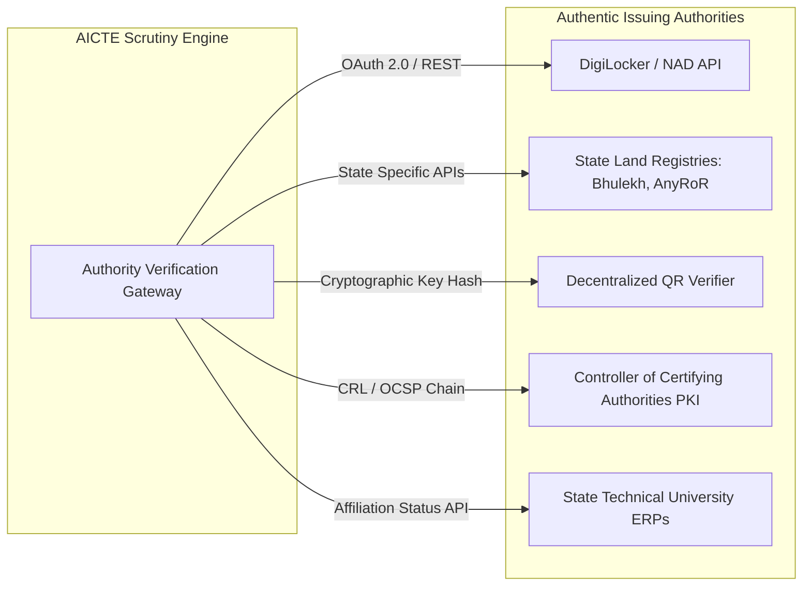

# AICTE EoA & Approval Scrutiny Platform: Exhaustive Research Dossier

> **Research Classification:** RegTech, Automated Scrutiny, Document Forensics, Computer Vision & Administrative Law Compliance  
> **Target Jurisdiction:** All India Council for Technical Education (AICTE), Ministry of Education, Government of India  
> **Compiled For:** SIH National Grand Finale & Engineering Benchmark Reference  

---

## 1. Regulatory Framework: AICTE Approval Process Handbook (APH)

### 1.1 Normative Land & Location Requirements
Under Chapter I & II of the AICTE Approval Process Handbook (APH), land and infrastructural requirements are categorized strictly by location classification:

| Institution Category | Mega Cities (Delhi, Mumbai, Kolkata, Chennai) | Metro Cities / State Capitals | Other Urban Areas | Rural Areas |
|---|---|---|---|---|
| **Engineering & Tech (UG/PG)** | 1.50 Acres | 2.50 Acres | 2.50 Acres | 7.50 Acres |
| **Management (MBA/PGDM)** | 0.50 Acres | 0.50 Acres | 1.00 Acres | 2.00 Acres |
| **Pharmacy (B.Pharm/M.Pharm)** | 0.75 Acres | 0.75 Acres | 1.00 Acres | 2.00 Acres |
| **Architecture (B.Arch)** | 1.00 Acres | 1.00 Acres | 1.50 Acres | 2.50 Acres |
| **Polytechnic (Diploma)** | 1.50 Acres | 1.50 Acres | 2.00 Acres | 4.00 Acres |

*Mandatory Rules:*
- Land must be contiguous or divided into no more than two plots separated by a public road of width not less than 12 meters.
- Land ownership must be in the name of the registered Trust/Society/Section 8 Company by clear Sale Deed or perpetual Government/Registered Lease (minimum 30 years).
- Non-Encumbrance Certificate (NEC) must be issued by a Sub-Registrar within the last 6 months.

---

### 1.2 Instructional & Administrative Area Norms
Carpet area standards mandated for institutions:
- **Classrooms:** Minimum 66 sq.m per classroom (for division size 60).
- **Tutorial Rooms:** Minimum 33 sq.m per room.
- **Laboratories (Engg/Tech):** Minimum 66 sq.m each; specialized heavy workshops require 200 sq.m.
- **Computer Centre:** Minimum 150 sq.m with a mandatory student-to-PC ratio of **1:4** for Engineering (or 1:6 for Management).
- **Library & Reading Room:** Minimum 400 sq.m with digital library facilities, DelNet/e-journals subscription proof.

---

### 1.3 Faculty Cadre Ratios & Faculty-to-Student Ratio (FSR)
The mandatory staffing standards are:
- **Faculty-to-Student Ratio (UG Engineering):** **1:20**
- **Faculty-to-Student Ratio (PG Engineering):** **1:15**
- **Faculty-to-Student Ratio (MBA / PGDM):** **1:20**
- **Faculty Cadre Ratio:** **1 : 2 : 6**  
  *(For every 1 Professor, there must be 2 Associate Professors and 6 Assistant Professors).*
- **Cadre Qualification Mandate:**
  - *Professor:* Ph.D. in relevant discipline + minimum 10 years experience (with at least 3 years as Associate Professor) + minimum 6 research publications in SCI/Scopus indexed journals.
  - *Associate Professor:* Ph.D. + minimum 8 years experience + minimum 2 SCI/Scopus publications.
  - *Assistant Professor:* Master's degree (M.Tech/M.E./MBA) with First Class or equivalent.

---

## 2. Document Forensics Science & Tampering Detection

### 2.1 Error Level Analysis (ELA)
When an image is saved in JPEG format, lossy compression divides the image into 8x8 pixel blocks and discards high-frequency details according to a specific quantization table.
- **Principle:** Every time an image is modified and re-saved, the modified area incurs a different rate of compression error compared to the untouched areas.
- **Implementation:**
  1. Re-compress the incoming raster image at a standardized quality level (e.g., 90% or 95%).
  2. Compute the absolute difference between the original pixel values and the re-compressed pixel values:
     $$\Delta I(x,y) = |I_{orig}(x,y) - I_{recomp}(x,y)|$$
  3. Scale $\Delta I(x,y)$ to visual dynamic range $[0, 255]$:
     $$\text{ELA}(x,y) = \min(255, \Delta I(x,y) \times \text{ScaleFactor})$$
  4. Spliced texts (such as forged dates on Fire NOCs) produce intense white/colored clusters due to differing quantization error histories.

```
+---------------------------------------------------------------------------------------------------+
|                                  ERROR LEVEL ANALYSIS (ELA) WORKFLOW                              |
+---------------------------------------------------------------------------------------------------+
|  Original Scan Image (JPEG/PDF)  ───►  Standard Recompression (95% Quality)                      |
|                                                     │                                             |
|                                                     ▼                                             |
|                                        Absolute Matrix Difference                                 |
|                                                     │                                             |
|                                                     ▼                                             |
|                                           Dynamic Scaling (x20)                                   |
|                                                     │                                             |
|                                                     ▼                                             |
|                                      High-Pass Thresholding & Bounding Box                        |
|                                                     │                                             |
|                                                     ▼                                             |
|                                       "Suspicious Alteration Detected!"                           |
+---------------------------------------------------------------------------------------------------+
```

---

### 2.2 PDF Structural & Metadata Forensics
Adversarial institutions frequently use desktop or online tools to alter legitimate certificates. An automated inspection parses the low-level PDF Cross-Reference (XREF) table and trailer streams:
- **Authoring Software Signature:** Scrutinize `/Producer` and `/Creator` metadata tags. Legitimate government portals generate PDFs using tools like `iText`, `Apache FOP`, or `JasperReports`. The presence of `Photoshop`, `Canva`, `iLovePDF`, `PDFescape`, or `GIMP` triggers an automatic **High-Risk Forensic Flag**.
- **Incremental Update Anomaly:** PDFs modified after cryptographic signing contain appended revision dictionaries (`/Prev` offsets). If modifications alter visual annotations over the text stream, the signature is rendered invalid.
- **Font Stream Discrepancy:** Scrutinize embedded fonts (`/Type /Font`). A scanned certificate is purely raster; if an adversary overlays digital text using Arial/Calibri, the PDF dictionary reveals mixed vector and raster streams on a single page.

---

### 2.3 Copy-Move & Nationwide Visual Duplication
- **Perceptual Hashing (pHash):** Converts document page layout into a 64-bit fingerprint using Discrete Cosine Transform (DCT). Enables matching even if a college re-scans a document at different brightness or resolution.
- **Deep Feature Embeddings:** Run document images through a lightweight vision backbone (ResNet-50 / EfficientNet) to generate 512-dimensional feature vectors stored in a vector index (Qdrant/Milvus). Enables detecting when College B submits an electricity bill or fire safety blueprint identical to College A located in another district.

---

## 3. Computer Vision for Physical Infrastructure Scrutiny

### 3.1 Object Detection for Instructional Assets (YOLOv8)
Technical institutions are required to upload geo-tagged photographs and video walkthroughs of:
- Computer Laboratories
- Physics / Chemistry / Electrical Engineering Labs
- Central Library
- Fire Safety & Emergency Evacuation Infrastructure

**AI Pipeline:**
1. A fine-tuned **YOLOv8x** model detects and segments instructional objects:
   - `computer_monitor`, `pc_cabinet`, `server_rack`, `projector_screen`, `fire_extinguisher`, `first_aid_box`, `cctv_camera`.
2. **Density & Layout Estimation:** Model counts detected objects and cross-references against self-declared claims:
   - *Example:* Claimed: 60 PCs in Lab 1. Model tally: 24 active monitors. Flag: **"Critical Infrastructure Deficit: Computer Count Mismatch"**.
3. **Screen Uniformity Check:** Adversarial colleges sometimes put cardboard mock-ups or turned-off monitors. Contrast analysis verifies active screen illumination.

---

### 3.2 Geo-Spatial & EXIF Verification
Every uploaded photograph must contain embedded EXIF metadata:
- `GPSLatitude`, `GPSLongitude`, `GPSAltitude`, `DateTimeOriginal`, `Make`, `Model`.

**Algorithmic Verification:**
1. **Ray-Casting Polygon Containment:** The AI engine maintains the officially surveyed Geo-JSON boundary polygon of the approved institution campus.
2. The coordinate $(Lat_p, Lon_p)$ is evaluated:
   $$\text{IsInside} = \text{PolygonContains}(CampusPolygon, (Lat_p, Lon_p))$$
3. If the coordinate lies outside the polygon (beyond a 100-meter GPS drift buffer), an alert is generated:
   > *"Alert: Computer Lab photo GPS coordinates (26.8467° N, 80.9462° E) lie 14.8 km outside the approved campus perimeter!"*
4. **EXIF Stripping Detection:** If an institution uploads images with stripped EXIF headers, the submission is categorized as non-compliant and requires re-upload through the official AICTE mobile validation app.

---

## 4. Issuing Authority Integration Ecosystem



### 4.1 DigiLocker / National Academic Depository (NAD)
- **Use Case:** Verification of faculty degrees (Ph.D., M.Tech, B.Tech) and National Board of Accreditation (NBA) certificates.
- **Protocol:** RESTful API with mTLS (Mutual TLS) and HMAC-SHA256 signature authentication.
- **Query Keys:** `AcademicYear`, `RollNumber`, `UniversityID`, `CandidateAadhaarHash`.
- **Payload Verification:** Automated string normalization and Levenshtein distance matching between candidate name on AICTE portal vs returned DigiLocker record ($Distance \le 1$).

---

### 4.2 State Land Record Registries (Bhulekh / Meebhoomi)
- **Use Case:** Verification of Khasra / Khatauni land title ownership.
- **State Adaptors:**
  - *Uttar Pradesh:* UP-Bhulekh API (`khasra_no`, `village_code`, `tehsil_code`).
  - *Gujarat:* AnyRoR RoR 7/12 & 8A extractor.
  - *Karnataka:* Bhoomi RTC verification service.
- **Validation Check:** Verify that the registered owner name matches the Applicant Educational Trust / Society name and not private individuals.

---

### 4.3 QR Code Cryptographic Decoding
Many state departments (Fire NOCs, Urban Local Bodies) issue certificates bearing encrypted 2D QR codes:
- **Verification Workflow:**
  1. The platform detects and extracts QR codes using OpenCV / pyzbar.
  2. Parse the underlying payload: JSON or cryptographically signed URL.
  3. Validate domain whitelist (e.g., `*.gov.in`, `*.nic.in`).
  4. Compare extracted document details (Certificate No, Validity Date, Institution Name) against the official web response.

---

## 5. Legal Safeguards & Regulatory Admissibility

### 5.1 Admissibility Under Section 65B of the Indian Evidence Act, 1872
Any electronic record produced by a computer system to support an administrative or judicial finding must satisfy Section 65B conditions:
1. **System Authenticity:** The platform operates under continuous, audited electronic operation during the relevant period.
2. **Chain of Custody:** Documents ingested are immediately hashed with SHA-256 and time-stamped using a National Informatics Centre (NIC) trusted time source.
3. **Automated 65B Certificate Generation:** Whenever an adverse action (e.g., Show Cause Notice, hearing, or withdrawal of approval) is initiated, the platform auto-generates a digitally signed **Section 65B Electronic Evidence Certificate** encapsulating file hashes, server IP, audit events, and tamper analysis logs.

---

### 5.2 Compliance with the Digital Personal Data Protection (DPDP) Act, 2023
- **Data Minimization:** Only statutory fields required for regulatory compliance are processed.
- **Automated PII Masking:**
  - *Aadhaar Number:* Automatically masks the first 8 digits (`XXXX-XXXX-1234`) across all uploaded faculty documents and ID proofs.
  - *Personal Bank Accounts:* Redacts personal financial numbers while retaining official salary credit transactions and EPF UAN numbers.
- **Role-Based Access Control (RBAC):** Restricts document visibility strictly to authorized regional desk officers and approved committee members.

---

## 6. Empirical Benchmarks & Evaluation Metrics

To evaluate prototype and production performance, the platform is assessed against standardized empirical benchmarks:

| Evaluation Metric | Baseline / Target | Measurement Methodology |
|---|---|---|
| **OCR Field Extraction Accuracy** | $\ge 96.5\%$ | Character Error Rate (CER) $\le 2\%$, Word Error Rate (WER) $\le 4\%$ on low-res scans. |
| **Forensic Alteration Recall** | $\ge 92.0\%$ | Precision/Recall against synthetic tampered dataset (spliced dates, cloned stamps). |
| **False Positive Alert Rate** | $\le 5.0\%$ | Critical to prevent unnecessary administrative hearings for legitimate colleges. |
| **End-to-End Processing Latency** | $\le 25\text{ seconds}$ | Complete ingestion, OCR, forensics, and rules engine execution for a 50-page submission. |
| **Authority API Matching Accuracy** | $100\%$ | Strict determinism for DigiLocker, QR, and Land registry API responses. |
| **Administrative Time Savings** | $\ge 80\%$ | Reduction in manual scrutiny hours per regional directorate. |
