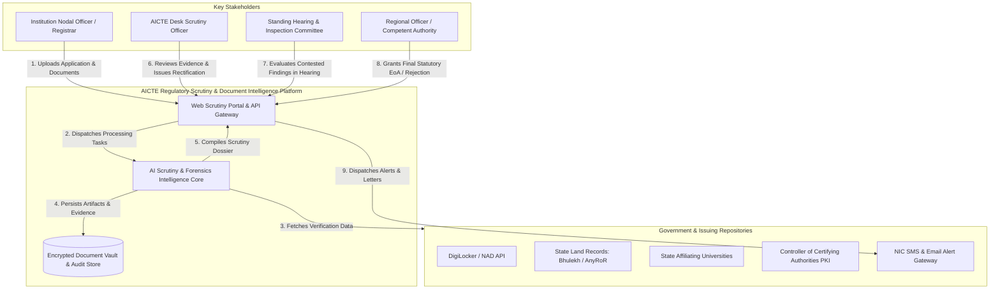
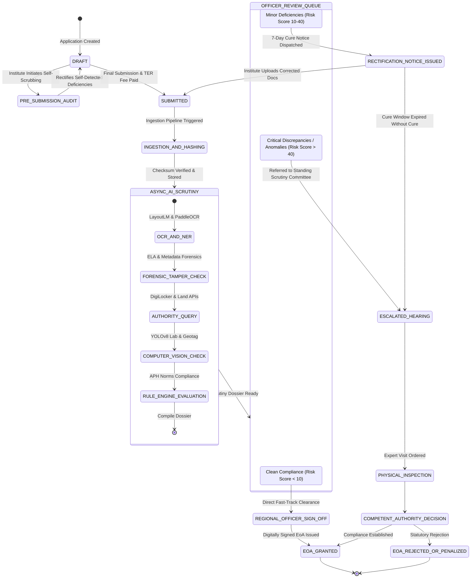
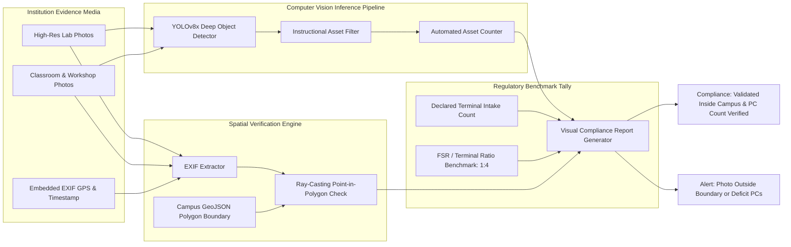
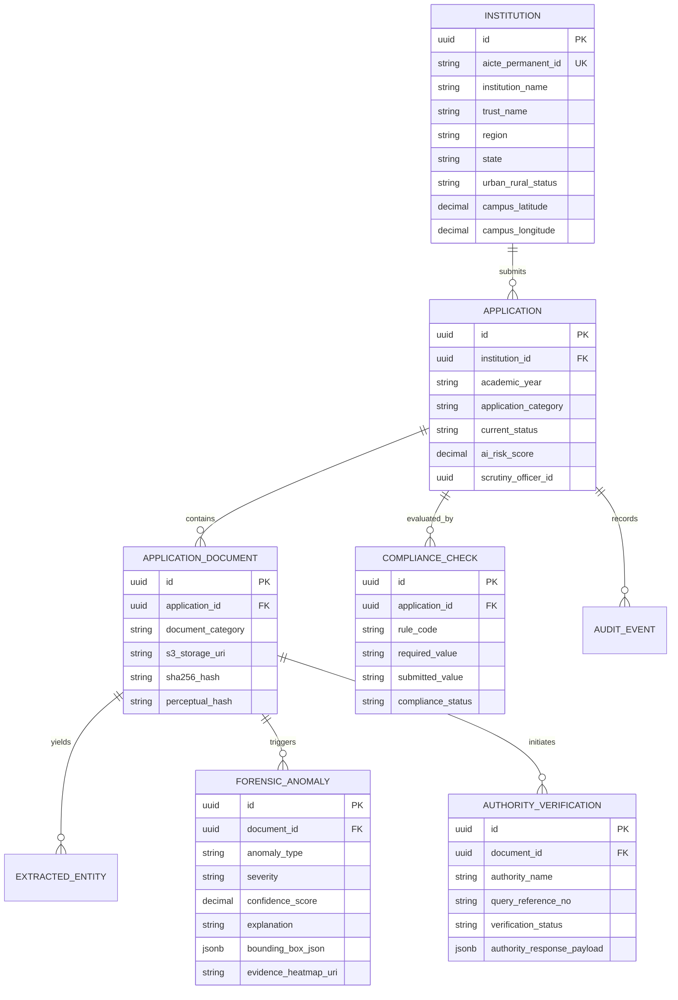

# AICTE EoA & Approval Scrutiny Platform: Visual Architecture & Diagrams Reference

> **Document Type:** System Architecture Diagrams, State Machines, Data Pipelines & Technical Visuals Reference  
> **Target System:** AICTE Automated Regulatory Scrutiny & Document Intelligence Platform (AICTE-ARSDIP)  

---

## 1. End-to-End System Context Diagram (C4 Level 1)



---

## 2. Document Scrutiny State Machine & Lifecycle



---

## 3. Computer Vision & Geotag Verification Architecture



---

## 4. Multi-Modal Document Forensics & ELA Architecture

```
                  ┌────────────────────────────────────────┐
                  │ Scanned Document / Certificate (PDF)   │
                  └───────────────────┬────────────────────┘
                                      │
                 ┌────────────────────┴────────────────────┐
                 ▼                                         ▼
   ┌───────────────────────────┐             ┌───────────────────────────┐
   │    Raster Conversion      │             │  PDF Stream & Byte Parser │
   │    (300 DPI Rendering)    │             │ (PyMuPDF / pdfminer.six)  │
   └─────────────┬─────────────┘             └─────────────┬─────────────┘
                 │                                         │
        ┌────────┴────────┐                       ┌────────┴────────┐
        ▼                 ▼                       ▼                 ▼
 ┌──────────────┐  ┌──────────────┐        ┌──────────────┐  ┌──────────────┐
 │ Error Level  │  │ Resampling & │        │   Metadata   │  │ Embedded Font│
 │ Analysis     │  │ Copy-Move    │        │ Authoring    │  │ Discrepancy  │
 │ (ELA) Engine │  │ pHash Engine │        │ Tool Audit   │  │ Layer Audit  │
 └──────┬───────┘  └──────┬───────┘        └──────┬───────┘  └──────┬───────┘
        │                 │                       │                 │
        └────────┬────────┴───────────────────────┴────────┬────────┘
                 │                                         │
                 ▼                                         ▼
   ┌─────────────────────────────────────────────────────────────┐
   │ Forensic Aggregator & Explainability Scoring Engine         │
   │ - Generates Visual Tamper Heatmaps (Red Glow Overlay)       │
   │ - Identifies Forensic Alteration Confidence Score           │
   │ - Localizes Dynamic Bounding Boxes (x1, y1, x2, y2)         │
   └──────────────────────────────┬──────────────────────────────┘
                                  │
                                  ▼
   ┌─────────────────────────────────────────────────────────────┐
   │ Split-Screen Scrutiny Dossier (Evidence-Linked Findings)    │
   └─────────────────────────────────────────────────────────────┘
```

---

## 5. Entity-Relationship Model (Data Schema ERD)


